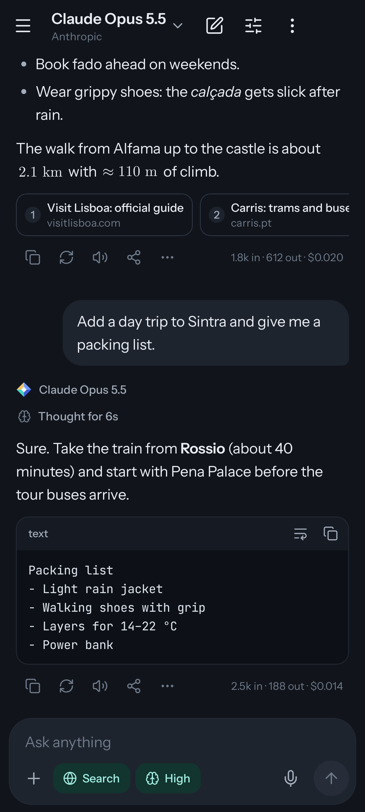
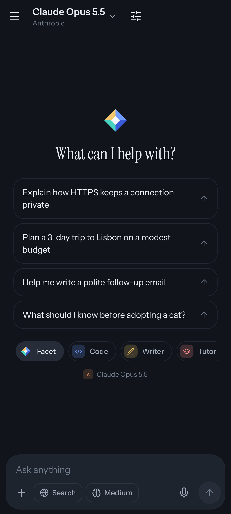
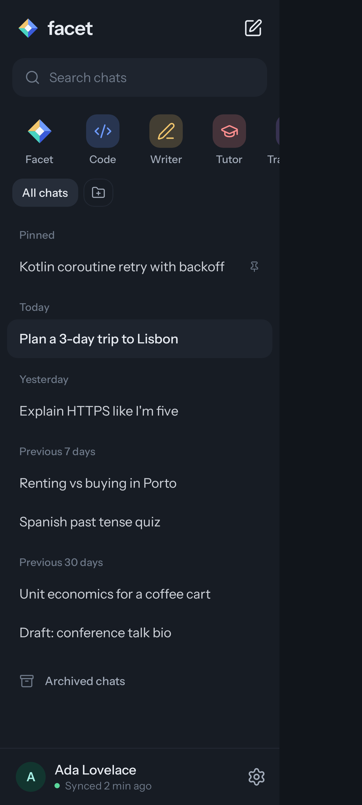

# Facet

**Every model. One home.** Facet is an open-source, end-to-end encrypted AI chat app for
Android, Windows and the web. Bring your own API keys for OpenAI, Anthropic, Google Gemini,
OpenRouter, xAI, DeepSeek, Mistral, Groq, or any OpenAI-compatible endpoint, and use every model
they offer from one fast app that syncs across all your devices. On Windows, models can also run
commands and read and edit files on your computer, with your approval.

Made by DT Software OÜ · [facet.dtsoftware.io](https://facet.dtsoftware.io) · Apache License 2.0

<p>
  
  
  
</p>

## Why Facet

- **Any key, any model.** Model lists are fetched live from each provider. Capabilities such as
  vision, reasoning levels, web search and context size come from provider metadata where it
  exists, so the app only shows controls a model supports.
- **Full control.** Reasoning effort (none → max), streamed reasoning summaries, verbosity,
  OpenAI pro mode, Anthropic fast mode, web search with citations, temperature, output limits,
  and per-chat instructions.
- **Private by construction.** Chats, attachments, assistants, prompts, settings and API keys are
  encrypted on the device before they sync. The sync server stores ciphertext it can't read,
  and never sees your password. Model requests go straight from your phone to the provider.
- **Fast and light.** Native Kotlin and Jetpack Compose on Android (the APK is about 3.6 MB);
  one shared TypeScript client for the web and Windows.
- **Your computer, too.** The Windows app gives models Claude Code-style tools: run PowerShell
  commands, read, write and edit files, search a folder, and start local MCP servers. Risky
  steps ask first.
- **Crafted.** One visual signature: the animated Facet gem. Everything else stays quiet.

Full feature list: [docs/PLAN.md](docs/PLAN.md).

## Repository

| Path | What it is |
|---|---|
| [`android/`](android/README.md) | The Android app (Kotlin, Compose, Room, OkHttp) |
| [`client/`](client/README.md) | The web app and the Windows app's interface (TypeScript, React, IndexedDB) |
| [`desktop/`](desktop/README.md) | The Windows app (Electron): computer tools, local MCP servers, DPAPI, updates |
| [`server/`](server/README.md) | Zero-knowledge sync server (Node.js 22, Fastify, SQLite) |
| [`web/`](web/README.md) | The public website for facet.dtsoftware.io |
| [`deploy/`](docs/DEPLOY.md) | Docker Compose + Caddy for hosting site, downloads and sync on one host |
| [`brand/`](brand/README.md) | Logo, wordmark and icon sources |
| [`docs/`](docs/) | Plan, API contract, security model, design system, deployment guide |

## Quick start

**Run the sync server locally**

```sh
cd server
npm install
cp .env.example .env
npm run dev          # http://localhost:8787/v1/health
npm test
```

**Build the Android app** (JDK 17+ and the Android SDK; see [android/README.md](android/README.md))

```sh
cd android
./gradlew assembleDebug          # app/build/outputs/apk/debug/app-debug.apk
./gradlew testDebugUnitTest      # unit, crypto-vector and screenshot tests
```

To point a debug build at your local server, open **Settings → Account → Sync server** before
signing in and enter `http://10.0.2.2:8787` (emulator) or your computer's LAN address.

**Run the web app** (Node 22; talks to a sync server on the same origin through Vite's proxy)

```sh
cd client
npm install
FACET_SYNC_URL=http://127.0.0.1:8787 npm run dev    # http://localhost:5173/app/
npm test
npm run build                                       # dist/, served at /app/
```

**Run and package the Windows app**

```sh
cd desktop
npm install
npm start                # builds the client for desktop and opens the app
npm test
npm run dist             # release/Facet-Setup-<version>.exe and latest.yml
```

**Deploy to facet.dtsoftware.io:** follow [docs/DEPLOY.md](docs/DEPLOY.md).

## Security

The design is documented in [docs/SECURITY.md](docs/SECURITY.md): PBKDF2-SHA256 (600k) and
HKDF key derivation on the device, a random vault key wrapped by your password and by a
one-time recovery code, AES-256-GCM for every record and file with the record id bound as
associated data, and rotating refresh tokens with theft detection. Test vectors in
[docs/test-vectors.json](docs/test-vectors.json) keep the Kotlin client and the TypeScript
reference implementation byte-for-byte compatible.

## License

Apache License 2.0. See [LICENSE](LICENSE). Third-party notices are listed in the app under
**Settings → About → Open-source licenses**.
